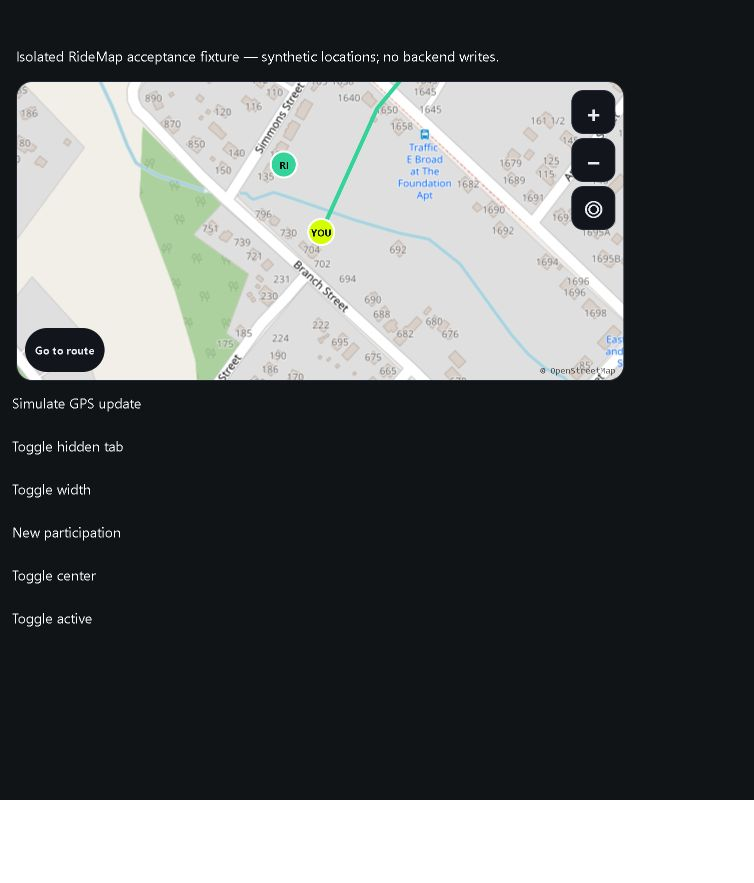

# Ride map pan and zoom verification

Date: November 15, 2026 (America/New_York).

Implemented the approved `2026-11-15-ride-map-pan-zoom.md` plan. `RideMap.tsx` owns rendering, manual camera, zoom, and responder gestures. `ComplicationsView.tsx` retains GPS, session subscriptions, stats, sharing, playback, and the tile warning. No dependencies or provider changes.

## Automated checks

- Baseline: 28 tests in 6 files passed; `npm run typecheck` passed.
- Final implementation: `npm test` passed 56 tests in 8 files; `npm run typecheck` passed.
- Geometry and component suites were first observed failing before their implementation. Interaction tests first failed for missing controls, gestures, and seam splitting.
- An additional regression reproduced a drag stopping when the pointer returned inside the initial threshold. The fix keeps the acquired drag active until release or interruption; its test now passes.
- `graphify update .` succeeded: 702 nodes, 1,387 edges, and 37 communities. It reported files without extractable symbols and changed community labels; no semantic labeling or API calls were performed.
- Coverage includes zoom limits and accessibility state, shared tile/overlay projection, antimeridian and polar geometry, interruption and multiple touches, web mouse-button normalization, hidden/zero-width layouts, participation reset, manual camera during GPS/route updates, and recentering with the existing 60-meter follow rule.

## Browser acceptance

Started Expo with `npx expo start --web --port 8082`. The application compiled and displayed its sign-in screen. An authenticated live session was unavailable, so integrated session acceptance was not performed.

Tested the actual `RideMap` component through a temporary, ignored Expo entry with synthetic locations and no backend writes. This used the real React Native Web renderer, SVG, tiles, and browser mouse input, rather than the Node host mocks.

| Check | Observation |
| --- | --- |
| Primary-button drag | A 100-by-25 pixel drag moved the route start from `(304,150)` to `(404,175)`; tile offsets changed by the same displacement. |
| Zoom | Zoom 16 changed to 17, route displacement doubled around the camera, and rectangle height remained 300. |
| Manual camera during location update | After panning and zooming, a synthetic GPS update moved the own trail endpoint while the route start stayed at `(504,200)`. |
| Recenter and resumed follow | Recenter followed the latest own fix; a subsequent synthetic GPS update kept the own marker/trail endpoint at `(304,150)`. |
| Go to route | Route start stayed centered after a later synthetic GPS update; zoom remained 17. |
| Width and hidden layout | Changing the map width from 608 to 320 and hiding/showing its wrapper retained route centering and zoom 17; height remained 300. |
| Participation reset | A new component key reset zoom to 16 and centered on the current follow target. |
| Empty states | Active and lobby placeholder messages rendered with no map controls when the follow target was absent after reset. |
| Tile loading | OSM tiles rendered during the fixture test. Tile error notification and parent warning placement were verified in automated tests; a real network failure was not induced. |

## Unverified targets and limits

- Android and iOS were not exercised. No Android `adb` executable was available on PATH; no iOS test target was used.
- Browser touch emulation was attempted, but the in-app browser does not support `Input.dispatchTouchEvent`. Browser touch and physical one-finger/second-finger behavior remain unverified.
- The actual app's Ride/Pack/Music navigation, GPS permission denial, live sharing, speed/distance/elapsed display, and audio during gestures were not verified in an authenticated device session. Existing lifecycle tests remain green, and those production effects were retained in the parent.
- Mouse hover and native image drag-ghost events were not instrumented separately. Real dragging moved the map; the image/overlay layer is noninteractive and sits below the gesture surface.
- This feature does not establish the cause of the previously reported mobile map failure and does not migrate the map provider.

## Execution decisions

- The user's request to follow and execute the plan approved its proposed defaults. No additional Superdesign canvas was generated; the CLI preflight succeeded and reported an authenticated session.
- Work remained in the existing `bug-fix` checkout to preserve the current workspace. Commits stage only task code, tests, generated graph output, and this acceptance evidence. Existing `.gitignore`, `AGENTS.md`, and untracked plans remain untouched.
- The report and screenshot extend the planned file list only to retain the required real-input evidence and unavailable-target record.
- Graph output was refreshed locally. No graph files are tracked, and the user's existing `.gitignore` edit excludes `graphify-out/`, so the generated output was not force-added to the commits. Consumers of the commits must rebuild the graph.

## Independent review

A separate reviewer examined the complete implementation range `eec601b..15113d6`, including the plan's five review focus areas and the execution decisions. The reviewer found no actionable correctness defects and independently reran all 56 tests and TypeScript successfully.

Provider migration, the previously reported mobile map failures, backend behavior, and unrelated workspace edits remain outside this map-only change. This preserves the requested scope; it does not resolve the documented device and authenticated-session verification gaps.
